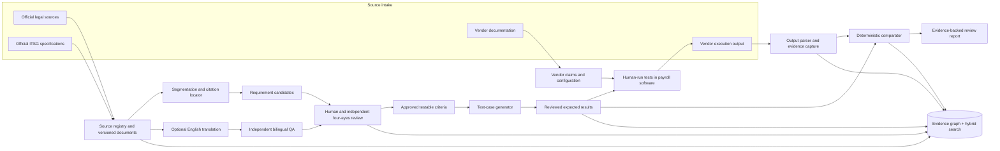

# ITSG AI Review Assistant — Architecture

**Purpose:** A traceable assistant for reviewing payroll software against applicable requirements for German income-replacement benefits (*Entgeltersatzleistungen*).

**Design principle:** AI helps people find, structure, translate, and test requirements. It does not decide what the law means, approve a formula, or certify a vendor. Any result must point back to its source and the exact test evidence.

## 1. Scope and safety boundary

The ITSG presentation (23 October 2026, especially pp. 9–12) frames the challenge as supporting the testing of payroll software for income-replacement benefits, with examples such as maternity and sickness benefits. Its proposed loop is: generate technical test cases; have people run them in payroll software; inspect the resulting datasets; and report the review. The stated assistant objectives are to identify relevant requirements, translate them into testable criteria, generate cases with expected results, create traceable records, compare results, and deliver understandable reports.

The larger target architecture also covers official legal and ITSG source ingestion, German-to-English translation with independent bilingual QA, legally reviewed deterministic functions, mathematical validation, and continuous test generation. These are separate capabilities with separate approval gates. They are not assumed to fit into the hackathon prototype.

**A zero-defect outcome is the safety target, not a guarantee.** No AI system or finite test suite can prove that all legal interpretations, inputs, software paths, or future changes are error-free. The assistant must be allowed to say “uncertain,” “source conflict,” or “not reviewed.” It must never convert missing evidence into a pass.

### In scope

- Requirements and test criteria for *Entgeltersatzleistungen* only.
- Source documents and software documentation as distinct input types.
- Traceability from a requirement to test cases, execution evidence, findings, and approvals.
- Human review at every material interpretation or release gate.
- Synthetic or minimized data for the prototype; no unnecessary payroll or personal data.

### Out of scope for the 24-hour prototype

- A claim of legal compliance, certification, or production readiness.
- Calculating an actual person's benefit or encoding a benefit formula without a verified, current authoritative source and qualified legal review.
- Treating vendor documentation as proof of what executable software did.
- Uploading real employee/payroll data to an unapproved service.

## 2. High-level design



The graph is the traceability backbone. Hybrid search (keyword plus vector search) helps reviewers find relevant passages; it is a navigation aid, not an authority ranking or a substitute for opening the cited source. For a prototype, a relational store with explicit links is sufficient. Add a graph database only when its traversal needs justify the extra setup.

## 3. Components and responsibilities

| Component | Responsibility | Must not do |
|---|---|---|
| Source registry | Store each document and its provenance, version, dates, checksum, language, and status. Preserve the original file. | Silently replace an older edition or assume the newest publication is applicable to every test date. |
| Segmenter and citation locator | Split documents into stable page/section/paragraph units and retain page labels, headings, and offsets. | Rewrite the source text or emit a requirement without a locator. |
| Requirement assistant | Suggest atomic requirement candidates, conditions, exceptions, and source citations. Mark ambiguity and missing context. | Declare a candidate legally correct or approve its own output. |
| Translation assistant and bilingual reviewer | Produce a clearly labeled working translation and flag terminology or meaning differences for an independent bilingual reviewer. | Replace the German source or treat machine translation as legal authority. |
| Human review gate | A qualified reviewer accepts, edits, rejects, or escalates requirements and criteria. A second reviewer checks high-impact items. | Treat an AI review as equivalent to legal or domain-expert approval. |
| Test-case assistant | Suggest normal, boundary, invalid-input, and regression cases from approved criteria. Keep generated values and rationale visible. | Invent an expected benefit amount or derive one from an unapproved formula. |
| Deterministic test/check library | Run explicitly specified checks with typed inputs, versioned code, and reproducible output. | Infer rules from prompt text at runtime or silently fall back to an LLM. |
| Vendor intake | Store vendor manuals/configuration as claims about intended behavior; store actual test output as a separate execution artifact. | Confuse documentation, screenshots, or marketing claims with observed execution. |
| Comparator and report | Compare observed output to reviewed expected output, record tolerances and differences, and show the evidence chain. | Call a test a legal pass when its criterion, source, expected result, or execution evidence is missing. |
| Orchestrator | Move work through explicit states, assign role-specific tasks, enforce gates, and record failures/retries. | Give one agent authority to approve requirements, its own tests, and the final report. |
| Audit log | Append who/what/when/version for source changes, model runs, edits, reviews, approvals, executions, and report generation. | Rewrite the history when a source or conclusion changes. |

## 4. Source authority, versions, and effective dates

Each source record should include at minimum:

```text
source_id, title, issuing_body, source_type, official_uri_or_origin,
retrieved_at, published_or_issued_at, edition_or_version,
valid_from, valid_to, language, checksum,
supersedes, status, reviewer, notes
```

Keep **publication/version date** separate from **effective date**. A test must select the source version applicable to the scenario's relevant date, where the source provides that information. If the applicable date or version cannot be established, stop and request review rather than choosing “latest.” Preserve prior versions so an old test can be reproduced.

Use this source handling order as a *review workflow*, not as a machine-resolved conflict rule:

1. Applicable enacted legal text from an official publication/source.
2. Current official ITSG specifications, instructions, and test materials for the technical review scope.
3. Other official guidance or clarifications, with issuing body and status recorded.
4. Vendor documentation and configuration, which describe vendor claims or intended behavior.
5. User notes, secondary explanations, and AI-generated summaries or translations.

Legal text and technical specifications can answer different questions. If they appear inconsistent, if applicability is unclear, or if a source is superseded or incomplete, create a **source conflict** finding for a qualified human. Do not resolve conflicts through embedding similarity, model confidence, or recency alone. Validate the current official source and its effective date before relying on any legal rule.

## 5. Requirements, citations, and evidence graph

Represent every requirement as an atomic, reviewable record:

```json
{
  "requirement_id": "REQ-...",
  "statement_de": "...",
  "working_translation_en": null,
  "source_version_id": "SRCV-...",
  "citation": {"page": 0, "section": "...", "paragraph": "..."},
  "applicability": {"conditions": [], "relevant_date": null},
  "interpretation_notes": "...",
  "status": "candidate | needs_review | approved | rejected | superseded",
  "reviewers": [],
  "approved_at": null
}
```

Approved criteria add observable behavior, inputs, expected output/relationship, units and rounding rules where authoritative material specifies them, exceptions, and the source for each value. A test case references criteria rather than copying a rule without its link.

Core graph nodes: `Source`, `SourceVersion`, `Segment`, `Requirement`, `Criterion`, `TestCase`, `FunctionVersion`, `VendorDocument`, `Execution`, `Evidence`, `Finding`, `Review`, and `Approval`.

Core edges: `versionOf`, `supersedes`, `contains`, `cites`, `derivedFrom`, `translatedFrom`, `implements`, `tests`, `executedAgainst`, `produced`, `supportsFinding`, `reviewedBy`, and `approvedBy`.

An auditor should be able to follow:

`report finding → observed output → execution → test case → approved criterion → requirement → exact source version and passage → reviews and approvals`.

Use lexical search, vector search, and graph traversal together. Show the exact German passage and document metadata beside every retrieved result. Store embeddings with the source-version/segment ID and rebuild or invalidate them when that segment changes.

## 6. Translation and deterministic calculation controls

### Translation

The original German text remains canonical. Keep translations aligned at segment level, with model/version, prompt version, timestamp, reviewer, and status recorded. A separate bilingual reviewer compares the translation against the cited German segment, checks legally significant terms and negation/conditions, and records corrections. A translation that has not passed that review is labeled **working translation — unverified** and cannot be used as the sole basis for a criterion.

### Calculation or validation functions

Only implement a legal calculation after qualified reviewers have approved a versioned rule specification with authoritative citations, applicability conditions, units, rounding, caps/floors, dates, and exceptions. Implement the approved specification as ordinary deterministic code. Keep function version and source links with every result.

Validate with independently hand-calculated examples, boundary and invalid cases, invariants/property-based checks, regression cases, and a second reviewer who did not author the implementation. Tests can find defects; they do not prove the code is correct for every case. If the official basis or expected result is missing, return **not evaluated** rather than an invented result.

## 7. Four-eyes review and human gates

“Four eyes” means two independent checks by people or an independent reviewer workflow, with the AI providing assistance rather than substituting for either accountable reviewer.

| Gate | Required evidence | Human decision |
|---|---|---|
| G0 — Source intake | Origin, issuer, version/date fields, checksum, scope | Accept source, mark incomplete, or reject |
| G1 — Requirement | Exact source passage, extracted statement, applicability, uncertainty | Approve, edit, reject, or seek legal/domain advice |
| G2 — Translation (if used) | German source and aligned English text | Bilingual reviewer accepts or corrects |
| G3 — Criterion and expected result | Approved requirement, testable rule, explicit expected result and rationale | Domain reviewer approves; second reviewer checks high-impact logic |
| G4 — Execution | Test identity, software/version/configuration, sanitized inputs, raw output and timestamp | Tester confirms run integrity and evidence is sufficient |
| G5 — Report | Comparator result, unresolved items, citations, reviewer history | Reviewer signs off or blocks release of the report |

An AI checker may flag missing citations, inconsistent units, duplicate cases, or unsupported claims. Its output is a review suggestion, not an approval event. The same model/agent must not be the sole author and reviewer of a requirement, test, or result.

## 8. Vendor materials, execution results, and privacy

Maintain two separate tracks:

- **Vendor documentation/configuration:** what the vendor says the system supports or how it is configured.
- **Execution evidence:** what a specified software version actually produced for a specified test input.

Associate an execution with the vendor document/version when relevant, but never substitute the document for a run. Capture a test ID, software build/version, configuration, synthetic input reference, operator, run timestamp, raw output checksum, and parser version. Preserve the original result and parsed fields so comparisons can be reproduced.

Prefer synthetic test records. Do not collect names, tax identifiers, bank information, or full payroll records for a test that only needs a small set of values. Redact or tokenize inputs before upload; keep raw files local or in an approved protected store; set retention and deletion rules; restrict access; and never send sensitive payroll data to a model/API without explicit organizational approval and suitable controls. The hackathon demo should use fabricated data only.

## 9. Orchestration and prompt contracts

Use a small explicit workflow/state machine rather than a free-running swarm:

`INGESTED → SOURCE_CHECKED → SEGMENTED → REQUIREMENTS_CANDIDATE → HUMAN_APPROVED → CASES_CANDIDATE → HUMAN_APPROVED → EXECUTED → COMPARED → REPORT_REVIEWED`.

Any missing source, citation, reviewer, or expected value moves the item to `BLOCKED` or `NEEDS_REVIEW`; retries never skip a gate. An orchestrator can delegate to narrowly defined roles (source segmenter, requirement extractor, translation drafter, test designer, independent consistency checker, report writer), but all agents receive only the necessary documents and return structured records with source IDs and citations.

Every agent prompt contract should define:

- role and allowed task;
- approved source IDs and source authority limits;
- required structured output schema;
- citation requirement for each factual/legal statement;
- explicit instruction to mark unknowns and conflicts instead of guessing;
- forbidden actions (approving its own work, inventing formulas, treating vendor claims as execution evidence);
- model and prompt version, and an audit event for each run.

## 10. 24-hour MVP architecture

Build a single local or controlled demo workflow:

1. Import one provided or approved **technical specification excerpt** and record its source metadata. Do not assume the presentation itself contains benefit formulas; it describes the challenge and intended workflow.
2. Let a user mark or review a small number of requirement candidates with page/section citations.
3. Create manually reviewed criteria and 3–5 synthetic test cases with expected values copied from the approved fixture. If no authoritative expected value exists, use an explicitly labeled non-legal software-behavior fixture or omit numeric comparison.
4. Import a fabricated vendor output file (CSV/JSON) as **execution output**, distinct from a vendor manual.
5. Run deterministic field/value checks and show pass, mismatch, or not evaluated with evidence links.
6. Generate a short report and an append-only event log showing the source, requirement, test, run, comparison, and human review.

Use a simple relational store or versioned JSON files and ordinary keyword search. A graph view, vector database, live legal-source crawler, automatic legal translation, and benefit calculator are later steps unless the team already has a reliable working component. This keeps the demo aligned to the ITSG presentation without implying legal correctness it cannot establish.

## 11. Later production hardening

Before use in a real review process: validate all source feeds and version/effective-date behavior with ITSG/domain experts; threat-model uploads and model/API boundaries; obtain legal and privacy review; define source update monitoring and regression policy; test parsers against real formats using approved sanitized samples; independently audit calculation functions; secure access, retention, and backups; and define a controlled pilot with human sign-off and an incident/correction process. The hackathon prototype is a workflow demonstrator only.

## Source basis

- *Futury Hackathon 2026 — Englisch*, ITSG challenge slides 9–12 (dated 23 October 2026): scope, proposed review loop, assistant objectives, and optional prototype.
- User's accompanying notes: payroll software outputs, official instructions/specifications, *Entgeltersatzleistungen*, traceability, testing, human expertise, changes over time, and the aspirational zero-error target. Notes are treated as context, not legal authority.

